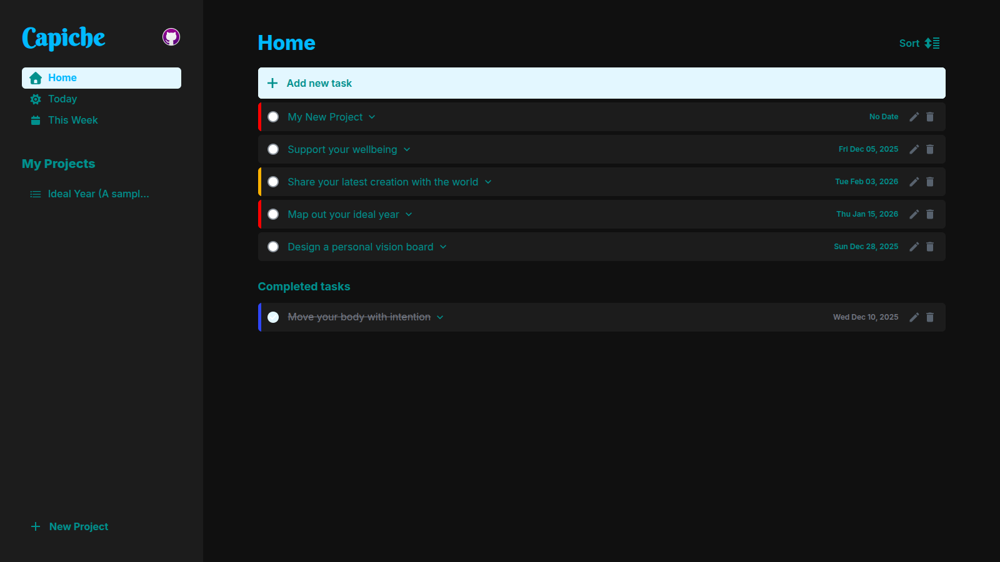

# Capiche — Task Management Application

[](https://opensource.org/licenses/MIT)
[](https://www.ecma-international.org/ecma-262/)
[](https://webpack.js.org/)

> A modern, lightweight task management application built with vanilla JavaScript, featuring project organization, smart date filtering, and an elegant dark-themed interface.



[Live Demo](https://sid2169.github.io/Capiche/) • [Report Bug](https://github.com/Sid2169/Capiche/issues) • [Request Feature](https://github.com/Sid2169/Capiche/issues)

---

## 📋 Table of Contents

- [Overview](#-overview)
- [Features](#-features)
- [Architecture](#-architecture)
- [Getting Started](#-getting-started)
- [Project Structure](#-project-structure)
- [Key Design Decisions](#-key-design-decisions)
- [Technical Highlights](#-technical-highlights)
- [Browser Support](#-browser-support)
- [Future Enhancements](#-future-enhancements)
- [Contributing](#-contributing)
- [License](#-license)

---

## 🎯 Overview

**Capiche** is a productivity-focused task management application that helps users organize their work through projects, prioritize tasks, and maintain focus on what matters today. Built without any frameworks, it demonstrates how clean vanilla JavaScript with thoughtful architecture can deliver a powerful user experience.

### Why Capiche?

- **🚫 Framework-free**: Pure JavaScript with no runtime dependencies
- **💾 Offline-first**: Works entirely in the browser with localStorage
- **⚡ Fast & Lightweight**: No build-time bloat, optimized bundle size
- **📱 Responsive**: Seamless experience across desktop, tablet, and mobile
- **♿ Accessible**: Semantic HTML with ARIA labels throughout

---

## ✨ Features

### Core Functionality

#### 📁 Project Management
- Create unlimited custom projects
- Inline project renaming with live updates
- Delete projects with cascading task removal
- Visual project navigation in collapsible sidebar
- Persistent project state across sessions

#### ✅ Task Management
- **Rich task creation** with:
  - Title (required)
  - Detailed description (950 char limit)
  - Due date with calendar picker
  - Priority levels (None, Low, Medium, High)
- Edit tasks in-place with modal interface
- Mark tasks as complete/incomplete with visual feedback
- Task details expansion for long descriptions
- Smart date validation and formatting using `date-fns`

#### 🗓️ Smart Filtering
- **Home**: All tasks across all projects
- **Today**: Tasks due today (timezone-aware)
- **This Week**: Weekly task overview
- Per-project task isolation

#### 🔄 Sorting & Organization
- Sort tasks by due date (ascending/descending/reset)
- Visual sort state indicators with icons
- Maintains sort order when adding new tasks
- Overdue date highlighting

#### 🎨 Priority System
- Four priority levels with distinct color coding:
  - **None**: Default state
  - **Low**: Blue indicator
  - **Medium**: Yellow indicator
  - **High**: Red indicator
- Priority-based visual cues on task cards

#### 💾 Data Persistence
- Automatic localStorage synchronization
- No server required - works offline
- Instant load times (< 100ms)
- Sample data generation on first launch
- Graceful degradation if localStorage unavailable

---

## 🏗️ Architecture

### Design Philosophy

Capiche follows a **modular, separation-of-concerns** architecture inspired by MVC patterns but adapted for vanilla JavaScript. The application is structured into distinct layers:

```
┌─────────────────────────────────────────────┐
│        Application Entry (app.js)            │
│  • Imports global assets                     │
│  • Initializes storage engine                │
│  • Bootstraps UI modules                     │
└─────────────────────────────────────────────┘
                     │
        ┌────────────┴────────────┐
        │                         │
┌───────▼────────┐      ┌────────▼─────────┐
│  Data Layer    │      │    UI Layer      │
│                │      │                  │
│ • projects.js  │◄────►│ • ui-projects.js │
│ • tasks.js     │      │ • ui-tasks.js    │
│ • storage.js   │      │ • ui-menu.js     │
└────────────────┘      └──────────────────┘
         │                       │
         └───────────┬───────────┘
                     ▼
              ┌─────────────┐
              │ localStorage │
              └─────────────┘
```

### Module Breakdown

#### **Data Layer** (`src/modules/`)

##### `projects.js`
- **Purpose**: Manages project state and business logic
- **Key Components**:
  - `projectsHandler`: Singleton object managing project collection
  - `createProject()`: Factory function for project objects
  - ID counter for unique identifiers
- **Responsibilities**:
  - Project CRUD operations
  - Project ID management
  - No direct DOM manipulation (pure data)

##### `tasks.js`
- **Purpose**: Task data management and operations
- **Key Components**:
  - `tasksHandler`: Central controller for task state
  - `task()`: Factory function for consistent task objects
- **Responsibilities**:
  - Task CRUD operations
  - Completion state toggling
  - Date object initialization
  - Project-based task filtering logic

##### `storage.js`
- **Purpose**: Persistence layer abstraction
- **Key Components**:
  - `initStorage()`: Bootstrap function
  - `updateProjectsStorage()`: Project persistence
  - `updateTasksStorage()`: Task persistence
- **Responsibilities**:
  - localStorage read/write operations
  - Fallback sample data injection
  - Data serialization/deserialization
  - Storage initialization and validation

#### **UI Layer** (`src/modules/ui/`)

##### `ui-projects.js`
- **Purpose**: Project interface rendering and interactions
- **Key Features**:
  - Dynamic project list rendering
  - Active tab state management
  - Inline project title editing
  - Project deletion with confirmation
  - New project form handling
- **Interactions**:
  - Coordinates with `ui-tasks.js` for task rendering
  - Updates `storage.js` on changes
  - Manages workspace title synchronization

##### `ui-tasks.js`
- **Purpose**: Task rendering engine and modal management
- **Key Features**:
  - Task list rendering with filtering
  - Date-based sorting (ascending/descending)
  - Create/Edit modal management
  - Form validation with visual feedback
  - Task completion UI updates
  - Empty state rendering
- **Complex Logic**:
  - Smart filtering by project/date
  - Sort state management (3-way toggle)
  - Dynamic form population for editing
  - Overdue date detection

##### `ui-menu.js`
- **Purpose**: Responsive navigation and overlay management
- **Key Features**:
  - Sidebar toggle for mobile/tablet
  - Dark overlay coordination
  - ResizeObserver for viewport changes
  - Modal/menu interaction handling
- **Responsive Behavior**:
  - Auto-closes sidebar above 992px
  - Prevents overlay conflicts with modals

---

## 🚀 Getting Started

### Prerequisites

- **Node.js** (v12+ recommended) and npm
- Modern web browser with ES6+ support:
  - Chrome 90+
  - Firefox 88+
  - Safari 14+
  - Edge 90+

### Installation

```bash
# Clone the repository
git clone https://github.com/Sid2169/to-do-list.git
cd to-do-list

# Install dependencies
npm install
```

### Development

```bash
# Start development server with hot module replacement
npm start

# The app will open automatically at http://localhost:8080
# Changes to files will trigger automatic reload
```

### Production Build

```bash
# Create optimized production build
npm run build

# Output will be in ./dist directory
# CSS is extracted and minified
# JS is minified and bundled
```

### Serving Production Build

```bash
# Serve the dist/ folder with any static file server
# Example with Python:
cd dist
python -m http.server 8000

# Or with Node's http-server:
npx http-server dist
```

---

## 📁 Project Structure

```
Capiche/
├── src/
│   ├── app.js                      # Application entry point
│   ├── index.html                  # Main HTML template
│   ├── style.css                   # Global styles
│   │
│   ├── modules/
│   │   ├── projects.js             # Project data management
│   │   ├── tasks.js                # Task data management
│   │   ├── storage.js              # localStorage abstraction
│   │   │
│   │   └── ui/
│   │       ├── ui-projects.js      # Project UI logic
│   │       ├── ui-tasks.js         # Task UI logic
│   │       └── ui-menu.js          # Navigation UI logic
│   │
│   ├── images/                     # Static image assets
│   │   ├── GitHub-Mark.png
│   │   └── walking-outside.png
│   │
│   └── assets/
│       └── fonts/                  # Custom web fonts
│           ├── berkshireswash-regular-webfont.woff
│           └── berkshireswash-regular-webfont.woff2
│
├── dist/                           # Production build output (generated)
│
├── webpack.common.js               # Shared Webpack config
├── webpack.dev.js                  # Development Webpack config
├── webpack.prod.js                 # Production Webpack config
│
├── package.json                    # Project metadata & scripts
├── package-lock.json               # Dependency lock file
│
├── .gitignore                      # Git ignore rules
└── README.md                       # This file
```

### Key Files Explained

- **`app.js`**: Application bootstrap - imports styles, initializes storage
- **`storage.js`**: Single source of truth for data persistence
- **`ui-*.js`**: View layer - renders DOM, handles events, no business logic
- **`webpack.*.js`**: Build configuration for dev/prod environments

---

## 🔑 Key Design Decisions

### 1. **No Framework Approach**

**Decision**: Build with vanilla JavaScript instead of React/Vue/Angular

**Rationale**:
- Demonstrates deep understanding of web fundamentals
- Zero runtime overhead (< 50KB total bundle)
- No framework lock-in or version dependencies
- Educational value for learning core JavaScript patterns

**Trade-offs**:
- Manual DOM manipulation (mitigated with clean helper functions)
- No virtual DOM diffing (offset by minimal re-renders)

### 2. **Module Pattern with Handlers**

**Decision**: Use handler objects (`projectsHandler`, `tasksHandler`) as singletons

**Rationale**:
- Centralized state management without Redux/Vuex complexity
- Single source of truth for data
- Easy to test and reason about
- Prevents multiple instances of state

**Example**:
```javascript
export const tasksHandler = {
  items: [],
  addTask(taskObj) { return this.items.push(taskObj) - 1; },
  removeTask(index) { return this.items.splice(index, 1); },
  // ...
};
```

### 3. **Factory Functions Over Classes**

**Decision**: Use factory functions (`task()`, `createProject()`) instead of ES6 classes

**Rationale**:
- Simpler syntax for object creation
- Avoids `this` binding issues
- Easier to compose and extend
- More functional programming style

**Example**:
```javascript
export const task = (title, details, date, priority, projectIndex, completed = false) => ({
  title, details, date, priority, completed, projectIndex
});
```

### 4. **localStorage for Persistence**

**Decision**: Use browser localStorage instead of backend database

**Rationale**:
- Zero server costs and maintenance
- Works offline by default
- Instant load times
- Privacy-focused (data never leaves user's device)

**Limitations**:
- ~5-10MB storage limit (sufficient for 1000s of tasks)
- No cross-device sync (could add Firebase/Supabase later)

### 5. **date-fns for Date Handling**

**Decision**: Use `date-fns` library instead of native Date API

**Rationale**:
- Reliable timezone handling
- Immutable date operations
- Excellent formatting utilities
- Tree-shakeable (only imports used functions)

**Usage**:
```javascript
import { format, isToday, isThisWeek, compareAsc } from "date-fns";
```

### 6. **Webpack for Build Tooling**

**Decision**: Use Webpack instead of Vite/Parcel/Rollup

**Rationale**:
- Industry-standard tool with vast ecosystem
- Powerful optimization capabilities
- Separate dev/prod configurations
- Asset management (images, fonts, CSS)

**Configurations**:
- `webpack.dev.js`: Hot reload, source maps, style-loader
- `webpack.prod.js`: Minification, CSS extraction, optimization

### 7. **CSS Variables for Theming**

**Decision**: Use CSS custom properties instead of Sass/LESS

**Rationale**:
- Native browser support (no preprocessing needed)
- Runtime theme switching capability
- Better performance (no recalculation)
- Clear, maintainable variable naming

**Example**:
```css
:root {
  --color-bg-primary: #101010;
  --text-color: #008b8b;
  --accent-color: #e6f7ff;
  --spacing-md: 15px;
}
```

### 8. **Mobile-First Responsive Design**

**Decision**: Design for mobile first, enhance for desktop

**Rationale**:
- Majority of users browse on mobile devices
- Easier to scale up than down
- Forces prioritization of essential features
- Better performance on constrained devices

**Breakpoints**:
- Mobile: < 768px
- Tablet: 768px - 992px
- Desktop: > 992px

---

## 💡 Technical Highlights

### 1. **Smart Date Filtering**

The application uses `date-fns` for accurate timezone-aware date comparisons:

```javascript
// Today filter
return tasksHandler.items.filter((task) => isToday(task.date));

// This Week filter
return tasksHandler.items.filter((task) => isThisWeek(task.date));
```

### 2. **Efficient DOM Rendering**

Uses DocumentFragment for batch DOM insertions to minimize reflows:

```javascript
const fragment = document.createDocumentFragment();
filteredTasks.forEach((task) => {
  fragment.prepend(createTaskUI(task, task.arrIndex));
});
tasksContainer.prepend(fragment);
```

### 3. **Three-Way Sort Toggle**

Implements intuitive sorting with visual feedback:

```javascript
// State transitions: null → asc → desc → null
if (!button.dataset.sort) button.dataset.sort = "asc";
else if (button.dataset.sort === "asc") button.dataset.sort = "desc";
else resetSortTasksBtn();
```

### 4. **Responsive Sidebar with ResizeObserver**

Automatically manages sidebar state based on viewport:

```javascript
const observer = new ResizeObserver(([entry]) => {
  const aboveBreakpoint = entry.contentRect.width > 992;
  if (aboveBreakpoint && sidebar.classList.contains("active")) {
    closeMenu();
  }
});
observer.observe(document.body);
```

### 5. **Form Validation with Accessibility**

Provides immediate, accessible feedback:

```javascript
function showInputError(input) {
  const errorNode = getClosestErrorMessage(input);
  if (errorNode) errorNode.classList.add("active");
}

// In HTML
<span class="invalid-input">Task must include a title.</span>
```

### 6. **Inline Editing with Event Handling**

Seamless project title editing:

```javascript
input.addEventListener("blur", () => {
  const value = input.value.trim() || "Untitled";
  workspaceTitle.innerText = value;
  currProject.title = value;
  updateProjectsStorage();
});
```

### 7. **Priority Visual Indicators**

CSS pseudo-elements for priority levels:

```css
.task.high-priority::before {
  content: "";
  position: absolute;
  width: 5px;
  height: 100%;
  background-color: var(--red);
}
```

---

## 🌐 Browser Support

### Fully Supported

- Chrome/Edge 90+ ✅
- Firefox 88+ ✅
- Safari 14+ ✅
- Opera 76+ ✅

### Minimum Requirements

- ES6+ JavaScript support
- CSS Grid & Flexbox
- localStorage API
- ResizeObserver API (for responsive behavior)

### Polyfills

No polyfills required for modern browsers. For legacy support, consider:
- `core-js` for ES6+ features
- `resize-observer-polyfill` for older browsers

---

## 🚧 Future Enhancements

### Planned Features

- [ ] **Cloud Sync**: Firebase/Supabase integration for cross-device sync
- [ ] **Drag & Drop**: Reorder tasks and projects
- [ ] **Recurring Tasks**: Daily/weekly/monthly task templates
- [ ] **Tags & Labels**: Flexible categorization beyond projects
- [ ] **Dark/Light Theme Toggle**: User preference storage
- [ ] **Keyboard Shortcuts**: Power user efficiency
- [ ] **Export/Import**: JSON/CSV data portability
- [ ] **Task Templates**: Pre-filled task creation
- [ ] **Search & Filter**: Global task search
- [ ] **Subtasks**: Nested task hierarchies

### Technical Improvements

- [ ] **Service Worker**: True offline PWA support
- [ ] **IndexedDB Migration**: Remove localStorage limitations
- [ ] **TypeScript**: Type safety and better tooling
- [ ] **Unit Tests**: Jest/Vitest test coverage
- [ ] **E2E Tests**: Playwright/Cypress integration
- [ ] **Performance Monitoring**: Web Vitals tracking

---

## 🤝 Contributing

Contributions are welcome! Please follow these steps:

1. **Fork the repository**
2. **Create a feature branch**: `git checkout -b feature/amazing-feature`
3. **Commit your changes**: `git commit -m 'Add amazing feature'`
4. **Push to the branch**: `git push origin feature/amazing-feature`
5. **Open a Pull Request**

### Development Guidelines

- Follow existing code style (ESLint config coming soon)
- Write descriptive commit messages
- Update README if adding features
- Test across multiple browsers
- Keep bundle size minimal

---

## 📄 License

This project is licensed under the **MIT License** - see the [LICENSE](LICENSE) file for details.

---

## 👤 Author

**Ead Adyreal** (Sid2169)

- GitHub: [@Sid2169](https://github.com/Sid2169)
- Project Link: [Capiche](https://github.com/Sid2169/to-do-list)

---

## 🙏 Acknowledgments

- **date-fns** - Modern date utility library
- **Google Fonts** - Inter typeface
- **Berkshire Swash** - Display font for branding
- **The Odin Project** - Project inspiration
- Community feedback and testing

---

<div align="center">

**Made with ❤️ and vanilla JavaScript**

If you found this project helpful, please consider giving it a ⭐!

</div>

## Additional Notes

- **date filtering** — Check the empty state after clearing local storage.
- **data import/export** — Check the empty state after clearing local storage.
- **keyboard shortcuts** — Add a screenshot or example when it clarifies the workflow.
- **data import/export** — Check the relevant browser or runtime support.
- **theme handling** — Keep the terminology consistent with the rest of the project.
- **production build** — Note any external service limits or required keys.
- **project module** — Verify that links and references still resolve.
- **theme handling** — Verify that links and references still resolve.
- **browser support** — Verify that project and task identifiers remain stable after a reload.
- **localStorage persistence** — Update the documentation if the visible behavior changes.
- **sorting** — Update the documentation if the visible behavior changes.
- **Webpack configuration** — Verify that project and task identifiers remain stable after a reload.
- **UI modules** — Keep the terminology consistent with the rest of the project.
- **Webpack configuration** — Add a screenshot or example when it clarifies the workflow.
- **Webpack configuration** — Check the relevant browser or runtime support.
- **keyboard shortcuts** — Verify the change in both development and production builds.
- **task module** — Check the relevant browser or runtime support.
- **accessibility** — Document any manual steps that cannot be automated.
- **storage layer** — Update the documentation if the visible behavior changes.
- **project module** — Confirm the expected behavior on a clean checkout.
- **production build** — Prefer small, focused changes over broad rewrites.
- **browser support** — Verify the change in both development and production builds.
- **browser support** — Keep commands copy-pasteable for new contributors.
- **keyboard shortcuts** — Include a short reproduction step when reporting issues.
- **empty states** — Check the relevant browser or runtime support.
- **keyboard shortcuts** — Check the relevant browser or runtime support.
- **date filtering** — Add a screenshot or example when it clarifies the workflow.
- **project module** — Verify that project and task identifiers remain stable after a reload.
- **UI modules** — Use the existing project patterns when extending this area.
- **task module** — Confirm the expected behavior on a clean checkout.
- **empty states** — Keep the terminology consistent with the rest of the project.
- **project module** — Check the required environment values before deploying.
- **data import/export** — Verify that project and task identifiers remain stable after a reload.
- **browser support** — Add a screenshot or example when it clarifies the workflow.
- **form validation** — Keep the related setup steps aligned with the current scripts.
- **date filtering** — Verify the change in both development and production builds.
- **storage layer** — Note any external service limits or required keys.
- **form validation** — Add a screenshot or example when it clarifies the workflow.
- **form validation** — Keep commands copy-pasteable for new contributors.
- **date filtering** — Keep commands copy-pasteable for new contributors.
- **theme handling** — Note any external service limits or required keys.
- **UI modules** — Check the required environment values before deploying.
- **browser support** — Confirm the expected behavior on a clean checkout.
- **browser support** — Use the existing project patterns when extending this area.
- **GitHub Pages deployment** — Confirm the expected behavior on a clean checkout.
- **project module** — Add a screenshot or example when it clarifies the workflow.
- **theme handling** — Verify the change in both development and production builds.
- **Webpack configuration** — Include a short reproduction step when reporting issues.
- **production build** — Keep commands copy-pasteable for new contributors.
- **theme handling** — Include a short reproduction step when reporting issues.
- **task module** — Use the existing project patterns when extending this area.
- **theme handling** — Verify that project and task identifiers remain stable after a reload.
- **date filtering** — Include a short reproduction step when reporting issues.
- **UI modules** — Verify that project and task identifiers remain stable after a reload.
- **GitHub Pages deployment** — Check the required environment values before deploying.
- **Webpack configuration** — Keep the related setup steps aligned with the current scripts.
- **production build** — Check the required environment values before deploying.
- **UI modules** — Verify the change in both development and production builds.
- **data import/export** — Verify the change in both development and production builds.
- **Webpack configuration** — Check the empty state after clearing local storage.
- **storage layer** — Prefer small, focused changes over broad rewrites.
- **keyboard shortcuts** — Note any external service limits or required keys.
- **date filtering** — Confirm the expected behavior on a clean checkout.
- **localStorage persistence** — Check the empty state after clearing local storage.
- **date filtering** — Check the relevant browser or runtime support.
- **localStorage persistence** — Keep the terminology consistent with the rest of the project.
- **empty states** — Prefer small, focused changes over broad rewrites.
- **date filtering** — Verify that project and task identifiers remain stable after a reload.
- **localStorage persistence** — Verify the change in both development and production builds.
- **priority system** — Check the empty state after clearing local storage.
- **data import/export** — Note any external service limits or required keys.
- **localStorage persistence** — Confirm the expected behavior on a clean checkout.
- **form validation** — Verify the change in both development and production builds.
- **localStorage persistence** — Keep the related setup steps aligned with the current scripts.
- **Webpack configuration** — Confirm the expected behavior on a clean checkout.
- **production build** — Verify that links and references still resolve.
- **Webpack configuration** — Prefer small, focused changes over broad rewrites.
- **browser support** — Check the required environment values before deploying.
- **sorting** — Keep the terminology consistent with the rest of the project.
- **keyboard shortcuts** — Update the documentation if the visible behavior changes.
- **GitHub Pages deployment** — Check the relevant browser or runtime support.
- **priority system** — Keep the related setup steps aligned with the current scripts.
- **UI modules** — Confirm the expected behavior on a clean checkout.
- **form validation** — Verify that links and references still resolve.
- **accessibility** — Note any external service limits or required keys.
- **sorting** — Verify the change in both development and production builds.
- **date filtering** — Keep the terminology consistent with the rest of the project.
- **accessibility** — Keep the related setup steps aligned with the current scripts.
- **Webpack configuration** — Verify that links and references still resolve.
- **GitHub Pages deployment** — Verify the change in both development and production builds.
- **production build** — Use the existing project patterns when extending this area.
- **Webpack configuration** — Document any manual steps that cannot be automated.
- **date filtering** — Keep the related setup steps aligned with the current scripts.
- **storage layer** — Check the required environment values before deploying.
- **accessibility** — Verify that links and references still resolve.
- **accessibility** — Verify that project and task identifiers remain stable after a reload.
- **task module** — Verify that project and task identifiers remain stable after a reload.
- **localStorage persistence** — Check the relevant browser or runtime support.
- **theme handling** — Document any manual steps that cannot be automated.
- **production build** — Keep the terminology consistent with the rest of the project.
- **empty states** — Document any manual steps that cannot be automated.
- **sorting** — Keep the related setup steps aligned with the current scripts.
- **task module** — Prefer small, focused changes over broad rewrites.
- **localStorage persistence** — Use the existing project patterns when extending this area.
- **task module** — Note any external service limits or required keys.
- **priority system** — Prefer small, focused changes over broad rewrites.
- **localStorage persistence** — Verify that links and references still resolve.
- **storage layer** — Check the empty state after clearing local storage.
- **theme handling** — Check the empty state after clearing local storage.
- **GitHub Pages deployment** — Keep commands copy-pasteable for new contributors.
- **task module** — Verify that links and references still resolve.
- **sorting** — Use the existing project patterns when extending this area.
- **keyboard shortcuts** — Check the empty state after clearing local storage.
- **browser support** — Check the empty state after clearing local storage.
- **browser support** — Include a short reproduction step when reporting issues.
- **empty states** — Keep commands copy-pasteable for new contributors.
- **GitHub Pages deployment** — Use the existing project patterns when extending this area.
- **date filtering** — Use the existing project patterns when extending this area.
- **production build** — Document any manual steps that cannot be automated.
- **GitHub Pages deployment** — Document any manual steps that cannot be automated.
- **data import/export** — Prefer small, focused changes over broad rewrites.
- **priority system** — Check the required environment values before deploying.
- **UI modules** — Prefer small, focused changes over broad rewrites.
- **keyboard shortcuts** — Document any manual steps that cannot be automated.
- **keyboard shortcuts** — Prefer small, focused changes over broad rewrites.
- **form validation** — Check the relevant browser or runtime support.
- **empty states** — Verify that project and task identifiers remain stable after a reload.
- **data import/export** — Keep the terminology consistent with the rest of the project.
- **production build** — Keep the related setup steps aligned with the current scripts.
- **localStorage persistence** — Keep commands copy-pasteable for new contributors.
- **project module** — Check the relevant browser or runtime support.
- **date filtering** — Note any external service limits or required keys.
- **GitHub Pages deployment** — Verify that project and task identifiers remain stable after a reload.
- **UI modules** — Document any manual steps that cannot be automated.
- **theme handling** — Keep the related setup steps aligned with the current scripts.
- **sorting** — Prefer small, focused changes over broad rewrites.
- **browser support** — Verify that links and references still resolve.
- **localStorage persistence** — Document any manual steps that cannot be automated.
- **empty states** — Confirm the expected behavior on a clean checkout.
